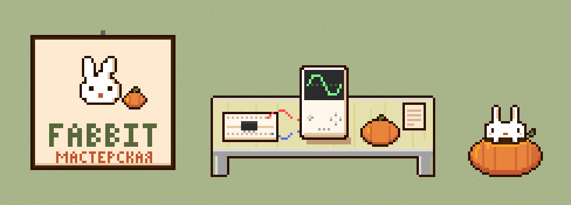
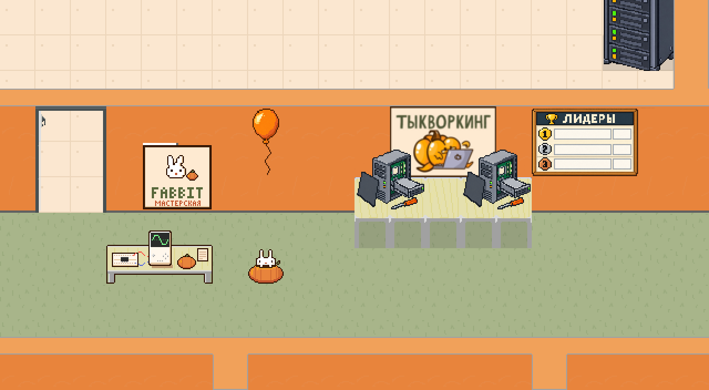
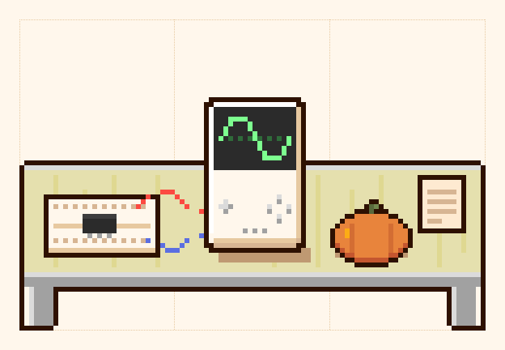
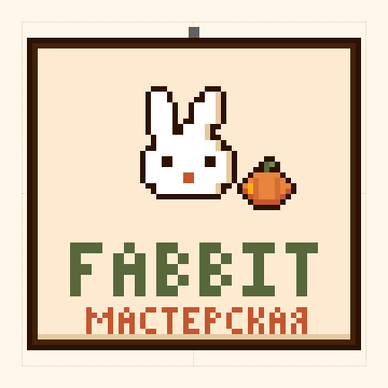
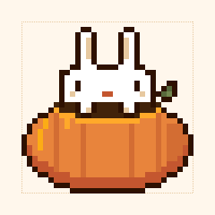
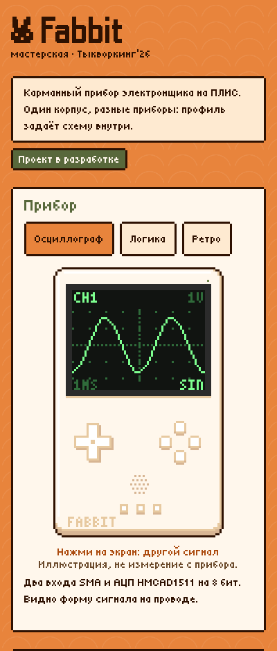
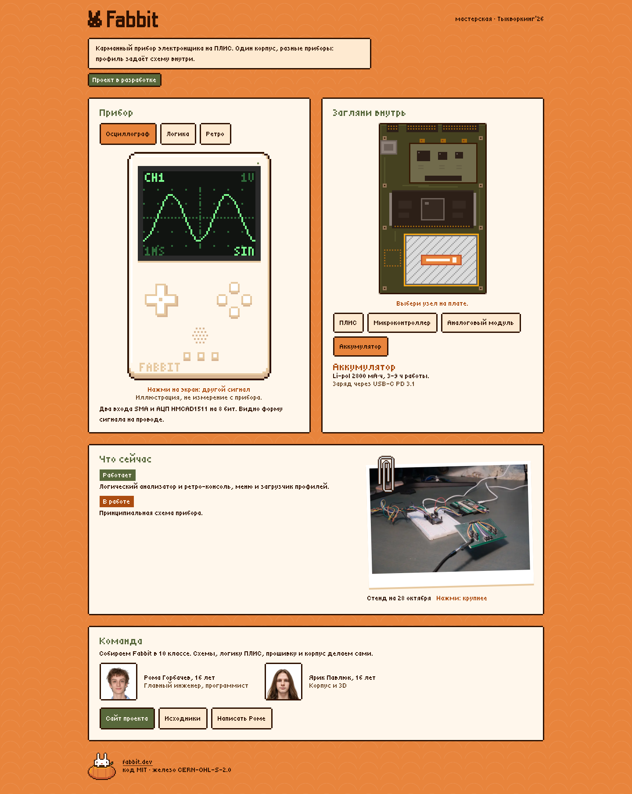
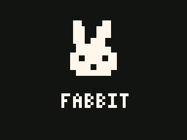
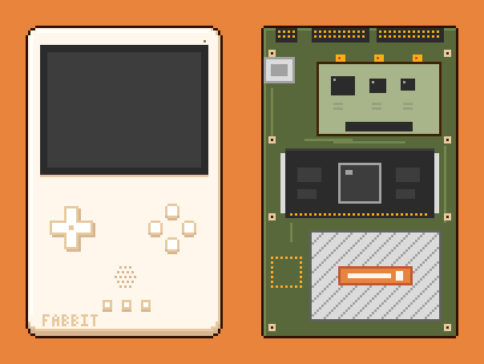
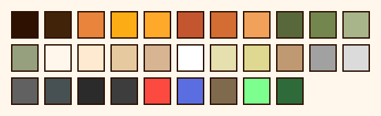

<h1 align="center">
  
</h1>

<p align="center"><b>Мастерская Fabbit</b> на Тыкворкинге’26 МЭИ: страница и пиксельная графика для онлайн-мира конференции.</p>

<p align="center">
  <a href="https://lab.fabbit.dev"></a>
  <a href="https://fabbit.dev"></a>
  <a href="https://github.com/fabbit-dev/fabbit"></a>
</p>

[Fabbit](https://fabbit.dev): карманный прибор электронщика на ПЛИС. В онлайн-мире Тыкворкинга стоит наш стол. Нажмите на него, и сбоку откроется эта страница. На ней вы переключите профиль прибора, заглянете в плату и увидите стенд на сегодня.

## В мире конференции

Мир работает на Куб.Мета, форке WorkAdventure. Клетка карты 32×32 px, объект в мире: картинка со ссылкой. Палитру и контур мы взяли из тайлсета мира, и стол не выделяется среди мебели организаторов.

<p align="center">
  
</p>

<table>
  <tr>
    <td align="center" width="50%"></td>
    <td align="center" width="30%"></td>
    <td align="center" width="20%"></td>
  </tr>
  <tr>
    <td align="center"><b>Стол</b> · 96×64, 3×2 клетки<br><a href="https://lab.fabbit.dev">lab.fabbit.dev</a></td>
    <td align="center"><b>Постер</b> · 64×64<br><a href="https://fabbit.dev">fabbit.dev</a></td>
    <td align="center"><b>Кролик</b> · 32×32<br><a href="https://lab.fabbit.dev">lab.fabbit.dev</a></td>
  </tr>
</table>

Пунктир на картинках показывает клетки мира. Готовые PNG в 1x с прозрачным фоном лежат в [`public/world/`](public/world), ссылки к ним в [`links.json`](public/world/links.json).

## Страница

Мир открывает страницу во вкладке сбоку, и мы верстали её под ширину около 400 px. На десктопе панели встают в два столбца.

<table>
  <tr>
    <td valign="top" width="28%"></td>
    <td valign="top"></td>
  </tr>
</table>

**Прибор.** Три профиля на одном экране: осциллограф, логический анализатор и ретро-консоль. Нажмите на экран: сигнал сменится, байты UART разберутся, кролик прыгнет через тыкву. На экране иллюстрация, измерений с прибора здесь нет.

<p align="center">
  
</p>

**Загляни внутрь.** Плата без задней крышки, на ней четыре узла: ПЛИС, микроконтроллер, аналоговый модуль и аккумулятор. Узел выбирается кликом по плате или кнопкой.

**Что сейчас.** Список того, что уже запускается на стенде, и над чем работаем. Рядом фото стенда на скрепке: нажмите, и оно откроется крупно.

**Команда.** Рома и Ярик, ссылки на проект, исходники и Telegram.

<p align="center">
  
</p>

## Как сделана графика

Спрайты описаны кодом: сетки символов и прямоугольники в [`art/sprites/`](art/sprites) и [`art/page/`](art/page). `npm run art` собирает PNG и проверяет формат для мира: размер кратен 32, цвета из палитры, пиксели без полупрозрачности. PNG руками не правим: меняем исходник и пересобираем.

<p align="center">
  
</p>

Палитра в [`art/palette.js`](art/palette.js): цвета из тайлсета мира и зелёный люминофор экрана Fabbit. Шрифт на странице один, [Tiny5](https://fonts.google.com/specimen/Tiny5), кегли 16 и 24 px. При этих кеглях пиксель глифа попадает на целые пиксели экрана. Отступы идут из шкалы 4–48 px, правила проверяет `src/style.test.js`.

## Запуск

Node.js 22 и npm.

```bash
npm ci
npm run dev        # localhost:5191
```

| Команда | Что делает |
|---|---|
| `npm test` | Тесты Vitest: экран, игра, разметка, дизайн-система, формат спрайтов |
| `npm run build` | Сборка в `dist/` |
| `npm run preview` | Просмотр сборки на [localhost:4174](http://localhost:4174) |
| `npm run art` | Спрайты для мира в `public/world/`, картинки страницы в `public/img/`, favicon |
| `npm run art -- --mock` | Ещё и мокап на куске карты мира в `art/out/mock.png` |
| `npm run docs` | Картинки для этого README в `docs/img/` |
| `node art/docs-shots.mjs` | Скриншоты страницы и `screen.gif`: нужен Chrome с `--remote-debugging-port=9337` |

```text
index.html          страница
src/screen.js       экран прибора 64×48: осциллограф, логика, ретро
src/main.js         профили, узлы платы, фото стенда
src/style.css       токены: шрифт, шкала отступов, палитра
art/sprites/        стол, постер, кролик для мира
art/page/           прибор, плата, скрепка, курсоры
public/world/       готовые PNG для организаторов
```

Изменения через PR: [CONTRIBUTING.md](CONTRIBUTING.md). Пуш в `main` публикует страницу на GitHub Pages.
